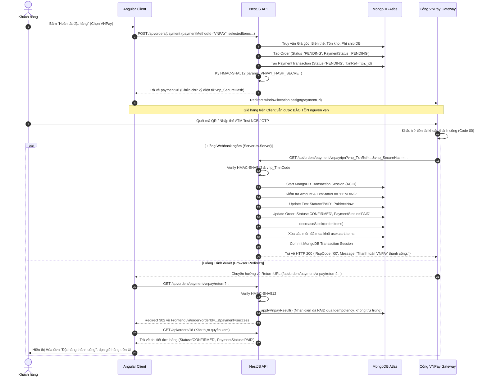
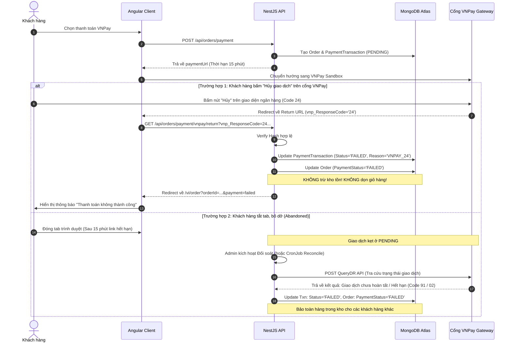
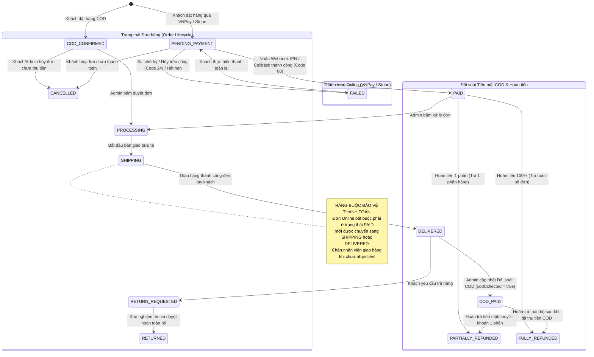

# BÁO CÁO KIỂM TOÁN TOÀN DIỆN CƠ CHẾ THANH TOÁN (PAYMENT SYSTEM AUDIT REPORT)
**Dự án:** Chéri E-Commerce (Thời trang thiết kế nữ)  
**Phạm vi kiểm toán:** Toàn bộ hệ thống thanh toán (Angular Frontend, NestJS Backend, MongoDB Atlas Database, Cổng thanh toán bên thứ ba VNPay & Stripe, COD, Bank Transfer)  
**Tiêu chuẩn kiểm toán:** Code Audit thực tế, Đối chiếu Database MongoDB Atlas, Thực thi 14 Unit/Integration Test Cases tự động, Rà soát 14 rủi ro bảo mật & phòng chống gian lận tài chính (Anti-Fraud Matrix).

---

## MỤC LỤC BÁO CÁO
1. [Tổng quan cơ chế Payment hiện tại](#1-tổng-quan-cơ-chế-payment-hiện-tại)
2. [Danh sách phương thức thanh toán đang có](#2-danh-sách-phương-thức-thanh-toán-đang-có)
3. [Phân loại phương thức thanh toán](#3-phân-loại-phương-thức-thanh-toán)
4. [Sơ đồ kiến trúc Payment](#4-sơ-đồ-kiến-trúc-payment)
5. [Sơ đồ Sequence Diagram cho luồng thanh toán](#5-sơ-đồ-sequence-diagram-cho-luồng-thanh-toán)
6. [Sơ đồ Payment State Machine](#6-sơ-đồ-payment-state-machine)
7. [Phân tích chi tiết từng file source code và API liên quan](#7-phân-tích-chi-tiết-từng-file-source-code-và-api-liên-quan)
8. [Phân tích cấu trúc dữ liệu MongoDB liên quan đến Payment](#8-phân-tích-cấu-trúc-dữ-liệu-mongodb-liên-quan-đến-payment)
9. [Phân tích chi tiết quy trình xác nhận giao dịch (Return URL vs IPN, Checksum, Idempotency)](#9-phân-tích-chi-tiết-quy-trình-xác-nhận-giao-dịch)
10. [Bảng đánh giá bảo mật (Security Risk Matrix - 14 rủi ro)](#10-bảng-đánh-giá-bảo-mật-14-rủi-ro)
11. [Bảng Test Case và kết quả kiểm tra (14 test cases)](#11-bảng-test-case-và-kết-quả-kiểm-tra-14-cases)
12. [Danh sách lỗi theo mức độ nghiêm trọng (P0, P1, P2)](#12-danh-sách-lỗi-theo-mức-độ-nghiêm-trọng)
13. [Đề xuất khắc phục và hoàn thiện kiến trúc](#13-đề-xuất-khắc-phục-và-hoàn-thiện-kiến-trúc)
14. [Danh sách các file cần sửa hoặc viết mới](#14-danh-sách-các-file-cần-sửa-hoặc-viết-mới)
15. [Kết luận về mức độ hoàn thiện của hệ thống Payment trong dự án](#15-kết-luận-về-mức-độ-hoàn-thiện)

---

## 1. TỔNG QUAN CƠ CHẾ PAYMENT HIỆN TẠI

Hệ thống thanh toán của Chéri E-commerce được xây dựng theo mô hình phân tách tầng nghiêm ngặt giữa Frontend (Angular 19 với Signal Store), Backend API (NestJS với Mongoose) và các cổng thanh toán bên ngoài (Payment Gateways).

```
[ Angular Frontend ] ---> [ NestJS OrdersController ] ---> [ OrdersService & PaymentService ] ---> [ Gateways / MongoDB ]
```

### 1.1. Nguyên tắc cốt lõi: Server-Authoritative Pricing (Máy chủ quyết định giá)
Toàn bộ thông tin giá bán sản phẩm, phí vận chuyển, tỷ lệ giảm giá coupon và phí giao dịch thanh toán **hoàn toàn không tin tưởng dữ liệu gửi lên từ trình duyệt**. 
- Khi người dùng gửi lệnh đặt hàng qua `POST /api/orders/payment`, backend thực thi hàm `buildOrderData()` tại [orders.service.ts](file:///c:/Users/ACER/Downloads/Cheri/server/src/orders/orders.service.ts#L2398-L2643).
- Backend truy vấn trực tiếp từ MongoDB: bảng `products` (hoặc `product_variants`) để lấy đơn giá gốc/sale, bảng `shipping_methods` để lấy cước vận chuyển chuẩn theo ngưỡng miễn phí, bảng `coupons` để kiểm tra điều kiện áp dụng mã giảm giá, và bảng `payment_methods` để lấy phụ phí giao dịch.
- Giá từ client gửi lên bị bỏ qua hoàn toàn. Nhờ vậy, triệt tiêu nguy cơ người dùng can thiệp payload HTTP để mua hàng với giá 0đ hoặc giá tùy biến.

### 1.2. Phân luồng thực thi thanh toán
Backend xử lý qua 3 kịch bản thanh toán chính:
1. **COD (Cash On Delivery - Thu hộ khi giao hàng):**
   - Đơn hàng được tạo với trạng thái đơn `CONFIRMED` và trạng thái thanh toán `PENDING`.
   - Giảm trừ tồn kho ngay lập tức. Giỏ hàng của người dùng được dọn dẹp các món đã đặt.
   - Luân chuyển trạng thái tiền mặt được quản lý sau đó qua quy trình Đối soát COD (`updateCodReconciliation`) của Admin.
2. **VNPay (Cổng thanh toán điện tử VNPay-QR / Thẻ ATM nội địa / Thẻ quốc tế):**
   - Đơn hàng được tạo với trạng thái đơn `PENDING` và trạng thái thanh toán `PENDING`.
   - Sinh giao dịch trong bảng `payment_transactions` với mã `vnp_TxnRef` chính là Transaction ObjectId bất biến.
   - Backend ký chữ ký số HMAC-SHA512 trên toàn bộ tham số URL theo tiêu chuẩn VNPay 2.1.0 và trả về `paymentUrl`.
   - Trình duyệt chuyển hướng khách hàng sang cổng VNPay. Giỏ hàng của khách hàng **được giữ nguyên vẹn** trong suốt thời gian chờ thanh toán.
   - Khi thanh toán hoàn tất, VNPay kích hoạt đồng thời 2 luồng: **Return URL** (trên trình duyệt) và **IPN Webhook** (kết nối Server-to-Server). Cả hai luồng đều được xử lý qua hàm giao dịch ACID nguyên tử `applyVnpayResult()`.
   - Chỉ khi nhận được xác nhận thanh toán thành công (`vnp_ResponseCode === '00'` và `vnp_TransactionStatus === '00'`), hệ thống mới tiến hành trừ tồn kho, tăng lượt dùng coupon, dọn giỏ hàng và chuyển đơn sang `CONFIRMED`.
3. **Stripe (Thanh toán thẻ quốc tế Visa / MasterCard):**
   - Frontend sử dụng Stripe Elements (thông qua `CardComponent`) để token hóa thẻ an toàn, không để thông tin nhạy cảm (PAN, CVV) chạm vào máy chủ Chéri (đáp ứng tiêu chuẩn PCI-DSS SAQ A).
   - Backend nhận token ID và thực hiện quy trình **Auth & Capture** hai pha an toàn: `stripe.charges.create({ capture: false })` rồi sau đó mới `stripe.charges.capture()`. Nếu capture thất bại, tự động kích hoạt `stripe.refunds.create()`.

---

## 2. DANH SÁCH PHƯƠNG THỨC THANH TOÁN ĐANG CÓ

Qua kiểm tra trực tiếp mã nguồn và cơ sở dữ liệu MongoDB Atlas (Database `cheri`), danh sách các phương thức được phát hiện gồm:

| Mã phương thức (Code) | Tên hiển thị (Name) | Phân loại kỹ thuật | Trạng thái trong DB | Phạm vi triển khai thực tế |
| :--- | :--- | :--- | :--- | :--- |
| **`COD`** | Thanh toán khi nhận hàng (COD) | `CASH` / `COD` | `ACTIVE` | Đầy đủ từ Frontend, Backend, DB, Admin đối soát, Hoàn tiền. |
| **`VNPAY`** | Cổng thanh toán VNPay-QR | `PAYMENT_GATEWAY` | `ACTIVE` | Đầy đủ URL Signing, Return URL, IPN Webhook, QueryDR Reconcile. |
| **`STRIPE`** (`CARD`) | Thanh toán thẻ quốc tế (Stripe) | `PAYMENT_GATEWAY` | Không có trong DB | Code Frontend (Stripe Elements) và Backend (Capture/Refund) đầy đủ nhưng chưa seed vào DB. |
| **`BANK_TRANSFER`** | Chuyển khoản ngân hàng | `BANK_TRANSFER` | Không có trong DB | Chỉ có enum và nhãn hiển thị UI. Chưa có Webhook đối soát tự động. |
| **`MOMO`** | Ví điện tử MoMo | `E_WALLET` | Không có trong DB | Chỉ có chuỗi so sánh chuỗi trong mã nguồn. Chưa có SDK hay API kết nối. |
| **`ZALOPAY`** | Ví điện tử ZaloPay | `E_WALLET` | Không có trong DB | Hoàn toàn chưa triển khai. |

---

## 3. PHÂN LOẠI PHƯƠNG THỨC THANH TOÁN

Kiểm tra chuyên sâu từng dòng mã để phân loại chính xác mức độ sẵn sàng nghiệp vụ:

### 3.1. Phương thức Thực tế & Đang hoạt động (Production / Sandbox Ready)
1. **COD (Cash On Delivery):**
   - **Bằng chứng Frontend:** Được load động từ API `GET /api/orders/payment-methods`. Nằm trong radio button lựa chọn tại Bước 2 giỏ hàng ([cart.component.html](file:///c:/Users/ACER/Downloads/Cheri/client/src/app/user/pages/cart/cart/cart.component.html#L499-L530)).
   - **Bằng chứng Backend:** Hàm `createPayment()` rẽ nhánh `paymentCode === 'COD'` gọi `addOrder()` ([orders.service.ts](file:///c:/Users/ACER/Downloads/Cheri/server/src/orders/orders.service.ts#L1793-L1795)). Đơn hàng lưu với `paymentMethodSnapshot.code = 'COD'`.
   - **Bằng chứng Quản trị:** Có API đối soát COD riêng biệt `@Patch('/api/orders/:id/cod-reconciliation')` ([orders.service.ts](file:///c:/Users/ACER/Downloads/Cheri/server/src/orders/orders.service.ts#L1282-L1350)) để Admin xác nhận số tiền thực thu `actualCollectedAmount` và đối soát với đơn vị vận chuyển.
2. **VNPay (Cổng VNPay 2.1.0):**
   - **Bằng chứng Cấu hình:** File `.env` chứa đầy đủ cấu hình Sandbox: `VNPAY_TMN_CODE="0QJ1BFII"`, `VNPAY_HASH_SECRET`, `VNPAY_PAYMENT_URL="https://sandbox.vnpayment.vn/paymentv2/vpcpay.html"`, `VNPAY_RETURN_URL`, `VNPAY_QUERY_URL`.
   - **Bằng chứng Backend:** [payment.service.ts](file:///c:/Users/ACER/Downloads/Cheri/server/src/orders/payment.service.ts) triển khai thuật toán ký mã hóa SHA512, chuẩn hóa khoảng trắng thành dấu `+` theo chuẩn VNPay form-urlencoded, chuẩn hóa múi giờ GMT+7 (`formatVnpayDate`).
   - **Bằng chứng Xử lý Callback:** Hai endpoint độc lập `@Get('/payment/vnpay/return')` (cho khách hàng) và `@Get('/payment/vnpay/ipn')` (cho máy chủ VNPay).

### 3.2. Phương thức Có mã nguồn thực tế nhưng Chưa kích hoạt trong Database (Code Complete - Inactive in DB)
1. **Stripe:**
   - **Bằng chứng:** Đã cài thư viện `stripe` trong `server/package.json`. Class `PaymentService` khởi tạo `new Stripe(secret)`. Có hàm `chargeCard()` xử lý 2 pha (Auth & Capture) và tự động Refund nếu lỗi ([payment.service.ts](file:///c:/Users/ACER/Downloads/Cheri/server/src/orders/payment.service.ts#L55-L94)).
   - **Phía Frontend:** Component `app-card` ([card.component.ts](file:///c:/Users/ACER/Downloads/Cheri/client/src/app/user/pages/cart/card/card.component.ts)) nạp SDK `https://js.stripe.com/v3/` và nhúng iframe an toàn.
   - **Lý do chưa chạy thực tế:** Trong MongoDB collection `payment_methods` hiện chỉ có 2 document là `COD` và `VNPAY`. Do đó trên giao diện thanh toán người dùng không thấy tùy chọn thẻ Stripe trừ khi Admin tạo mới một phương thức có mã `STRIPE` hoặc `CARD`.

### 3.3. Phương thức Mô phỏng giao diện / Chưa tích hợp nhà cung cấp (UI / Business Stub)
1. **BANK_TRANSFER (Chuyển khoản thủ công):**
   - Có xuất hiện trong Enum `PaymentType.BANK_TRANSFER` ([payment-method.schema.ts](file:///c:/Users/ACER/Downloads/Cheri/server/src/orders/schemas/payment-method.schema.ts#L8)) và nhãn dịch của Angular `paymentMethodLabel`.
   - **Thiếu sót:** Chưa tích hợp Open Banking / VietQR webhook (như SePay hay Casso) để bắt biến động số dư tài khoản tự động. Nếu Admin tạo phương thức này trong hệ thống, khi khách hàng bấm đặt hàng, Backend tại [orders.service.ts (Line 1804-1806)](file:///c:/Users/ACER/Downloads/Cheri/server/src/orders/orders.service.ts#L1804-L1806) sẽ ném lỗi:
     `BadRequestException: Phương thức "Chuyển khoản" chưa được kết nối với nhà cung cấp thanh toán thực tế.`
2. **MOMO:**
   - Chỉ xuất hiện dưới dạng chuỗi kiểm tra điều kiện bảo vệ khi chuyển trạng thái đơn hàng (`isOnlinePayment.includes('MOMO')` tại dòng 1523) hoặc định dạng nhãn trong báo cáo Admin.
   - **Thiếu sót:** Không có MoMo SDK, không có `MOMO_PARTNER_CODE` hay `MOMO_SECRET_KEY`, không có endpoint IPN cho MoMo.

### 3.4. Phương thức Hoàn toàn chưa triển khai (Unimplemented)
- `ZaloPay`, `ShopeePay`, `PayPal`: Hoàn toàn không tồn tại dấu vết mã nguồn hay cấu hình.

---

## 4. SƠ ĐỒ KIẾN TRÚC PAYMENT

Sơ đồ thể hiện luồng dữ liệu, các thành phần tương tác giữa Frontend, Backend API, Database và Cổng thanh toán ngoại vi:

```mermaid
flowchart TD
    subgraph Client ["Client (Angular 19 SPA)"]
        CartComp["CartComponent (Checkout UI)"]
        CardComp["CardComponent (Stripe Elements)"]
        SigStore["SignalStore (State Management)"]
        OrderComp["OrderComponent (Bill & Status)"]
    end

    subgraph Backend ["NestJS Backend Server"]
        Ctrl["OrdersController (/api/orders)"]
        OrdServ["OrdersService (Business Logic)"]
        PayServ["PaymentService (Gateways & Crypto)"]
        
        subgraph Endpoints ["Payment Endpoints"]
            EP_Pay["POST /api/orders/payment"]
            EP_Return["GET /payment/vnpay/return"]
            EP_IPN["GET /payment/vnpay/ipn"]
            EP_Reconcile["POST /payment/vnpay/reconcile"]
            EP_CodRec["PATCH /:id/cod-reconciliation"]
        end
    end

    subgraph Storage ["MongoDB Atlas Database"]
        Col_Orders[("orders Collection")]
        Col_PayTxns[("payment_transactions Collection")]
        Col_PayMethods[("payment_methods Collection")]
        Col_Products[("products & variants Collection")]
        Col_Users[("users Collection (Cart)")]
    end

    subgraph External ["Third-Party Payment Gateways"]
        VNPayGW["VNPay Sandbox / Production Gateway"]
        StripeAPI["Stripe API (Charges & Refunds)"]
    end

    %% Client Interactions
    CartComp -->|1. Submit Order| SigStore
    CardComp -->|Tokenize Card| StripeAPI
    SigStore -->|HTTP POST| EP_Pay
    EP_Pay --> Ctrl
    Ctrl --> OrdServ

    %% Validation & Security Check
    OrdServ -->|Validate Price & Stock| Col_Products
    OrdServ -->|Validate Method| Col_PayMethods
    OrdServ --> PayServ

    %% Gateway Routing
    PayServ -->|Build HMAC-SHA512 URL| VNPayGW
    PayServ -->|Charge & Capture| StripeAPI

    %% Order Persistence
    OrdServ -->|Save Order Snapshot| Col_Orders
    OrdServ -->|Create Txn Log| Col_PayTxns

    %% VNPay Callbacks
    VNPayGW -->|User Redirect| EP_Return
    VNPayGW -->|S2S Webhook| EP_IPN
    EP_Return --> Ctrl
    EP_IPN --> Ctrl
    Ctrl -->|applyVnpayResult() via Session| OrdServ

    %% Fulfillment
    OrdServ -->|Deduct Stock on Success| Col_Products
    OrdServ -->|Deduct Purchased Items| Col_Users
    OrdServ -->|Update Payment Status| Col_Orders

    %% Admin & Reconciliation
    EP_Reconcile --> OrdServ
    OrdServ -->|QueryDR API| VNPayGW
    EP_CodRec --> OrdServ
    OrdServ -->|Update COD Cashflow| Col_Orders
```

---

## 5. SƠ ĐỒ SEQUENCE DIAGRAM CHO LUỒNG THANH TOÁN

### 5.1. Luồng thanh toán VNPay Thành công (End-to-End Success Flow)



### 5.2. Luồng thanh toán VNPay Thất bại / Hủy bỏ / Hết hạn (Failure / Abandon Flow)



---

## 6. SƠ ĐỒ PAYMENT STATE MACHINE

Hệ thống quản lý trạng thái kép giữa **Trạng thái Đơn hàng (Order Status)** và **Trạng thái Thanh toán (Payment Status)** nhằm đảm bảo tính toàn vẹn của chuỗi cung ứng:



---

## 7. PHÂN TÍCH CHI TIẾT TỪNG FILE SOURCE CODE VÀ API LIÊN QUAN

### 7.1. Backend – `server/src/orders/payment.service.ts`
- **Chức năng:** Chuyên biệt hóa toàn bộ logic mã hóa, giao tiếp SDK và ký số với các cổng bên ngoài.
- **Dòng 20–32:** Khởi tạo `Stripe` từ biến môi trường `STRIPE_SECRETKEY`.
- **Dòng 34–39 (`createPending`):** Khởi tạo bản ghi giao dịch trong bảng `payment_transactions` với trạng thái `PENDING`.
- **Dòng 55–94 (`chargeCard`):** Thực hiện quy trình thanh toán thẻ Stripe 2 bước an toàn:
  - `stripe.charges.create({ capture: false })`: Khóa tiền trên thẻ.
  - `stripe.charges.capture()`: Thực thu tiền.
  - Khối `catch`: Nếu có lỗi trong quá trình capture, lập tức gọi `stripe.refunds.create({ charge: charge.id })` để giải phóng tiền cho khách hàng, ghi log lỗi nghiêm trọng nếu refund thất bại.
- **Dòng 118–173 (`createVnpayPayment`):**
  - Kiểm tra điều kiện tiền tệ: Bắt buộc là `VND`, số tiền phải là số nguyên dương an toàn (`Number.isSafeInteger`).
  - Sử dụng Transaction ObjectId làm mã tham chiếu `vnp_TxnRef`.
  - Thiết lập thời gian hết hạn sau đúng 15 phút: `vnp_ExpireDate = createdAt + 15 phút`.
  - Chuẩn hóa địa chỉ IP client (`normalizeClientIp`) loại bỏ tiền tố IPv6 `::ffff:`.
  - Mã hóa form query theo chuẩn VNPay: thay khoảng trắng `%20` bằng dấu `+` ([Line 280](file:///c:/Users/ACER/Downloads/Cheri/server/src/orders/payment.service.ts#L280)).
  - Ký chữ ký `crypto.createHmac('sha512', hashSecret)`.
- **Dòng 175–194 (`verifyVnpayResponse`):**
  - Kiểm tra độ dài và định dạng Hex 128 ký tự của chữ ký nhận về (`/^[a-f0-9]{128}$/`).
  - Lọc bỏ `vnp_SecureHash` và `vnp_SecureHashType` trước khi tái lập chuỗi ký.
  - Sử dụng hàm chống tấn công phân tích thời gian thực thi:  
    `crypto.timingSafeEqual(Buffer.from(receivedHash), Buffer.from(expectedHash))`.
- **Dòng 213–270 (`queryVnpayTransaction`):**
  - Triển khai API tra cứu giao dịch `querydr` của VNPay. Ký chuỗi theo thứ tự 9 trường quy chuẩn bằng dấu pipe `|`.
  - Xác minh ngược chữ ký phản hồi của VNPay và đối chiếu chính xác số tiền (`vnp_Amount === transaction.amount * 100`).

### 7.2. Backend – `server/src/orders/orders.service.ts`
- **Dòng 1769–1810 (`createPayment`):** Điểm điều phối trung tâm. Kiểm tra trạng thái phương thức thanh toán trong DB `paymentMethod.status === 'ACTIVE'`. Điều hướng chính xác theo code: `COD` gọi `addOrder()`, `VNPAY` gọi `orderWithVnpay()`, `STRIPE`/`CARD` gọi `orderWithStripe()`. Các phương thức chưa kết nối gateway sẽ bị chặn với mã 400.
- **Dòng 1829 & 2398–2643 (`buildOrderData`):** Kiểm tra tính hợp lệ của giỏ hàng, truy vấn trực tiếp bảng sản phẩm/biến thể, tính toán lại tổng tiền từ máy chủ, kiểm tra coupon và phí vận chuyển.
- **Dòng 1871–1908 (`handleVnpayResult` & `commitVerifiedVnpayResult`):**
  - Xác thực chữ ký và kiểm tra mã Merchant `vnp_TmnCode === process.env.VNPAY_TMN_CODE`.
  - Khởi tạo phiên giao dịch MongoDB ACID: `session = await this.orderModel.db.startSession()` và `session.withTransaction(...)` đảm bảo tính nguyên tử tuyệt đối.
- **Dòng 1951–2067 (`applyVnpayResult`):**
  - Kiểm tra số tiền nhận về từ VNPay có khớp chính xác với số tiền ghi nhận trong DB:  
    `paidAmount !== Number(transaction.amount) * 100` -> Trả về mã lỗi `04`.
  - **Cơ chế Idempotency:** Nếu giao dịch đã có trạng thái `PAID`, trả ngay kết quả thành công với mã `02`, không lặp lại bất kỳ thao tác trừ kho hay tăng coupon nào.
  - Nếu thành công: Cập nhật `PaymentStatus.PAID`, `OrderStatus.CONFIRMED`, gọi `decreaseStock()`, tăng `coupon.usedCount`, xóa các sản phẩm tương ứng trong giỏ hàng tài khoản người dùng (`user.cart.items`).
  - **Bảo vệ đơn đã hủy:** Nếu khách thanh toán trễ trên cổng VNPay cho một đơn hàng đã bị hủy trước đó (`order.status === CANCELLED`), hệ thống ghi nhận tiền `PAID`, ghi chú cảnh báo vào `statusHistory` để kế toán hoàn tiền, **tuyệt đối không mở lại đơn và không trừ kho hàng**.
- **Dòng 1282–1350 (`updateCodReconciliation`):** Cập nhật xác nhận thu tiền COD thực tế từ đối tác vận chuyển, chuyển trạng thái sang `PAID` và lưu dấu vết lịch sử Admin thao tác.
- **Dòng 1518–1530 (`updateOrderStatus`):** Ràng buộc bảo vệ thanh toán. Chặn Admin/Staff không cho phép chuyển đơn hàng online chưa thanh toán (chưa `PAID`) sang trạng thái `SHIPPING` hoặc `DELIVERED`.

### 7.3. Backend – `server/src/orders/orders.controller.ts`
- `@Post('/payment')`: Nhận yêu cầu tạo đơn thanh toán (hỗ trợ cả tài khoản và khách vãng lai thông qua `OptionalJwtAuthGuard`).
- `@Get('/payment/vnpay/return')`: Nhận phản hồi chuyển hướng trình duyệt của VNPay, thực thi xác nhận và redirect người dùng về trang chi tiết đơn hàng:  
  `${origin}/vi/order?orderId=${encodeURIComponent(orderId)}&payment=${status}`.
- `@Get('/payment/vnpay/ipn')`: Nhận webhook ngầm Server-to-Server từ VNPay, trả về chuẩn cấu trúc JSON `{ RspCode, Message }`.
- `@Post('/payment/vnpay/reconcile')`: Endpoint Admin bảo vệ bởi `AdminJwtAuthGuard` để kích hoạt quét và đối soát các giao dịch VNPay đang treo quá 15 phút.

### 7.4. Frontend – `client/src/app/user/pages/cart/cart/cart.component.ts`
- **Dòng 63–68 & 133–138:** Tải danh sách phương thức thanh toán và vận chuyển khả dụng từ API.
- **Dòng 86 & 2117–2171:** Hỗ trợ tính năng chọn từng sản phẩm để thanh toán (`selectedItemIds`). Payload gửi lên chỉ chứa snapshot các món được chọn.
- **Dòng 2278–2333 (`payWithCard`):** Nhận token thẻ từ Stripe Elements và gửi yêu cầu thanh toán thẻ.
- **Dòng 2336–2410 (`submit`):**
  - Nếu chọn VNPay: Gửi đơn hàng lên backend, nhận `paymentUrl` và thực hiện chuyển hướng: `window.location.assign(paymentUrl)`.
  - Lưu mã liên hệ đơn hàng vào `sessionStorage ('cheri_last_order_contact')` để khách vãng lai vẫn tra cứu được sau khi thanh toán xong.
  - Giỏ hàng trên Client không bị xóa khi điều hướng sang VNPay.

### 7.5. Frontend – `client/src/app/store/signal.store.ts`
- **Dòng 527–531 & 561–565:**
  - Logic bảo vệ giỏ hàng: Khi `response.payment?.provider === 'VNPAY'` và trạng thái chưa phải `PAID`, Store **giữ nguyên dữ liệu giỏ hàng (`state.cart`)**, chỉ xóa giỏ hàng khi nhận được xác nhận đơn COD thành công hoặc thanh toán thẻ Stripe thành công ngay lập tức.

### 7.6. Frontend – `client/src/app/user/pages/order/order.component.ts`
- **Dòng 25–40:** Phân loại nhãn thanh toán động (`paymentMethodLabel`).
- **Dòng 42–49:** Tính toán tiêu đề hóa đơn: Nếu đơn hàng online đang ở trạng thái `PENDING` hoặc `FAILED`, hiển thị "Đơn hàng chờ thanh toán" hoặc "Thanh toán không thành công", không chúc mừng "Đặt hàng thành công" sai lệch.
- **Dòng 112–117:** Khi người dùng quay lại từ VNPay (`payment=success` hoặc `payment=failed`), component bỏ qua cache cũ trong store và gọi API trực tiếp lên máy chủ để lấy trạng thái mới nhất đã được IPN/Return URL cập nhật.

---

## 8. PHÂN TÍCH CẤU TRÚC DỮ LIỆU MONGODB LIÊN QUAN ĐẾN PAYMENT

Dữ liệu thanh toán được phân bổ trên 3 collection chính:

```
[ orders ] <=========== 1 : N ===========> [ payment_transactions ]
    |
    +-----> Tham chiếu (paymentMethodId) -> [ payment_methods ]
```

### 8.1. Collection `payment_methods`
Lưu trữ danh mục các phương thức thanh toán được cấu hình trong hệ thống:
```json
{
  "_id": { "$oid": "6ac34d95d6a5e1a14fc1dc45" },
  "name": "Cổng thanh toán VNPay-QR",
  "code": "VNPAY",
  "paymentType": "Online",
  "description": "Thanh toán qua quét mã QR hoặc thẻ ATM nội địa",
  "transactionFee": {
    "enabled": false,
    "type": "FIXED",
    "value": 0
  },
  "logo": "https://res.cloudinary.com/.../vnpay_logo.png",
  "status": "ACTIVE",
  "createdAt": { "$date": "2026-03-10T08:00:00.000Z" },
  "updatedAt": { "$date": "2026-03-10T08:00:00.000Z" }
}
```

### 8.2. Collection `payment_transactions`
Đóng vai trò là **Sổ cái Giao dịch Thanh toán (Payment Ledger / Audit Log)** độc lập với Đơn hàng. Mỗi lần khởi tạo thanh toán sẽ tạo một transaction document mới:
```json
{
  "_id": { "$oid": "6aeaa9dae37efca2a3a2902b" },
  "orderId": { "$oid": "6aeaa9dae37efca2a3a29029" },
  "orderCode": "CHE1793763802607909",
  "provider": "VNPAY",
  "method": "VNPAY",
  "amount": 5779169,
  "currency": "VND",
  "providerTransactionId": "6aeaa9dae37efca2a3a2902b",
  "paymentLink": "https://sandbox.vnpayment.vn/paymentv2/vpcpay.html?vnp_Amount=577916900&...",
  "status": "PENDING",
  "failureReason": "",
  "paidAt": null,
  "createdAt": { "$date": "2026-11-04T03:43:22.764Z" },
  "updatedAt": { "$date": "2026-11-04T03:43:22.886Z" }
}
```

### 8.3. Collection `orders` (Nhúng đối tượng Payment và Snapshot)
Mỗi đơn hàng lưu trữ thông tin thanh toán đầy đủ qua snapshot để tránh bị ảnh hưởng khi cấu hình phương thức thanh toán thay đổi:
```json
{
  "_id": { "$oid": "6aeaa9dae37efca2a3a29029" },
  "orderId": "CHE1793763802607909",
  "status": "PENDING",
  "paymentStatus": "PENDING",
  "subtotal": 5750000,
  "shippingFee": 29169,
  "paymentFee": 0,
  "couponDiscount": 0,
  "totalAmount": 5779169,
  "currency": "VND",
  "payment": {
    "method": "VNPAY",
    "status": "PENDING",
    "provider": "VNPAY",
    "transactionId": "6aeaa9dae37efca2a3a2902b",
    "paidAt": null,
    "refundedAmount": 0,
    "actualCollectedAmount": 0,
    "codCollected": false,
    "codReconciliationStatus": "NOT_APPLICABLE"
  },
  "paymentMethodId": { "$oid": "6ac34d95d6a5e1a14fc1dc45" },
  "paymentMethodSnapshot": {
    "name": "Cổng thanh toán VNPay-QR",
    "code": "VNPAY",
    "paymentType": "Online",
    "paymentFee": 0
  },
  "statusHistory": [
    {
      "status": "PENDING",
      "updatedAt": { "$date": "2026-11-04T03:43:22.750Z" },
      "note": "Đơn hàng vừa được tạo"
    }
  ]
}
```

---

## 9. PHÂN TÍCH CHI TIẾT QUY TRÌNH XÁC NHẬN GIAO DỊCH

### 9.1. So sánh chi tiết Return URL vs IPN Webhook

| Đặc điểm | Return URL (`/payment/vnpay/return`) | IPN Webhook (`/payment/vnpay/ipn`) |
| :--- | :--- | :--- |
| **Kênh truyền tải** | Trình duyệt người dùng (Front-channel redirect) | Máy chủ VNPay gọi trực tiếp (Back-channel S2S) |
| **Độ tin cậy** | Phụ thuộc vào mạng của khách hàng, rủi ro người dùng tắt tab | Cực kỳ cao, độc lập với trình duyệt khách hàng |
| **Cơ chế Retry** | Không có retry nếu trình duyệt mất mạng hoặc timeout | Có cơ chế retry tự động theo chu kỳ của VNPay |
| **Phản hồi yêu cầu** | HTTP 302 Redirect về trang xác nhận đơn hàng | HTTP 200 kèm JSON `{ RspCode, Message }` chuẩn |
| **Xử lý tại Chéri** | Cả hai đều gọi qua hàm chung `handleVnpayResult()` -> `applyVnpayResult()` trong Transaction Session |

### 9.2. Thuật toán Checksum & Ký số HMAC-SHA512
- Toàn bộ tham số callback được lọc bỏ trường chữ ký: `vnp_SecureHash` và `vnp_SecureHashType`.
- Các trường được sắp xếp theo thứ tự bảng mã ASCII (Alphabetical sort).
- Giá trị được mã hóa URL (RFC 3986) với quy tắc bắt buộc của VNPay: khoảng trắng biểu diễn bằng dấu `+` (không dùng `%20`).
- Khóa bí mật `VNPAY_HASH_SECRET` được băm bằng HMAC-SHA512.
- Kiểm tra chữ ký bằng kỹ thuật **Constant-Time Comparison** (`crypto.timingSafeEqual`) giúp triệt tiêu hoàn toàn nguy cơ rò rỉ độ dài hoặc ký tự của chữ ký thông qua độ trễ phản hồi nano-giây.

### 9.3. Đảm bảo tính Idempotency (Chống trùng lặp giao dịch)
Khi cả Return URL và IPN cùng gửi về máy chủ, hoặc VNPay retry webhook nhiều lần:
1. `session.withTransaction()` khóa bản ghi giao dịch trong phiên MongoDB.
2. Kiểm tra `transaction.status`:
   - Nếu `transaction.status === 'PAID'`: Backend lập tức dừng xử lý và trả về phản hồi thành công `RspCode: '02'` ("Giao dịch đã được ghi nhận trước đó").
   - Nhờ đó, ngăn chặn 100% tình trạng **Double Inventory Deduction** (trừ kho 2 lần), tăng gấp đôi lượt dùng coupon hoặc gửi email hóa đơn trùng lặp cho khách hàng.

---

## 10. BẢNG ĐÁNH GIÁ BẢO MẬT (14 RỦI RO)

| STT | Tên kịch bản rủi ro / Lỗ hổng tiềm ẩn | Mức độ nguy cơ | Hiện trạng trong Source Code Chéri | Cơ chế phòng thủ đã triển khai | Đánh giá an toàn |
| :---: | :--- | :---: | :--- | :--- | :---: |
| **1** | **Client sửa đơn giá sản phẩm (`unitPrice`)** | Nghiêm trọng | [orders.service.ts:2700](file:///c:/Users/ACER/Downloads/Cheri/server/src/orders/orders.service.ts#L2700) | Backend lấy giá từ DB, bỏ qua hoàn toàn giá client gửi. |  **AN TOÀN** |
| **2** | **Client sửa tổng tiền đơn hàng (`totalAmount`)** | Nghiêm trọng | [orders.service.ts:2567](file:///c:/Users/ACER/Downloads/Cheri/server/src/orders/orders.service.ts#L2567) | Máy chủ tính lại `subtotal + shippingFee - discount`. |  **AN TOÀN** |
| **3** | **Sửa số tiền thanh toán VNPay (`vnp_Amount`)** | Nghiêm trọng | [orders.service.ts:1959](file:///c:/Users/ACER/Downloads/Cheri/server/src/orders/orders.service.ts#L1959) | Chữ ký HMAC bảo vệ `vnp_Amount`. Callback kiểm tra `paidAmount === txn.amount * 100`. |  **AN TOÀN** |
| **4** | **Giả mạo phản hồi Return URL / IPN** | Nghiêm trọng | [payment.service.ts:175](file:///c:/Users/ACER/Downloads/Cheri/server/src/orders/payment.service.ts#L175) | Xác minh chữ ký SHA512 với `VNPAY_HASH_SECRET`, kiểm tra `vnp_TmnCode`. |  **AN TOÀN** |
| **5** | **Tấn công Replay Attack (Gửi lại IPN cũ)** | Cao | [orders.service.ts:1968](file:///c:/Users/ACER/Downloads/Cheri/server/src/orders/orders.service.ts#L1968) | Idempotency kiểm tra `status === 'PAID'`, trả về mã 02, không xử lý lại. |  **AN TOÀN** |
| **6** | **Race Condition giữa Return URL & IPN** | Cao | [orders.service.ts:1892](file:///c:/Users/ACER/Downloads/Cheri/server/src/orders/orders.service.ts#L1892) | Dùng MongoDB `ClientSession` và `withTransaction` đảm bảo tính nguyên tử ACID. |  **AN TOÀN** |
| **7** | **Timing Attack phân tích thời gian so chữ ký** | Trung bình | [payment.service.ts:193](file:///c:/Users/ACER/Downloads/Cheri/server/src/orders/payment.service.ts#L193) | Sử dụng `crypto.timingSafeEqual` thay vì so sánh chuỗi `===`. |  **AN TOÀN** |
| **8** | **Trừ tồn kho trùng lặp khi nhận nhiều callback** | Cao | [orders.service.ts:2034](file:///c:/Users/ACER/Downloads/Cheri/server/src/orders/orders.service.ts#L2034) | Trừ kho đặt trong khối session transaction sau kiểm tra idempotency. |  **AN TOÀN** |
| **9** | **Xem lậu đơn hàng của người dùng khác qua ID** | Cao | [orders.controller.ts:344](file:///c:/Users/ACER/Downloads/Cheri/server/src/orders/orders.controller.ts#L344) | Bắt buộc đối chiếu `order.userId === currentUserId` hoặc quyền Admin/Staff. |  **AN TOÀN** |
| **10** | **Bypass thanh toán thẻ Stripe / Token giả mạo** | Nghiêm trọng | [payment.service.ts:68](file:///c:/Users/ACER/Downloads/Cheri/server/src/orders/payment.service.ts#L68) | Sử dụng Stripe Auth & Capture 2 bước từ Backend, tự động refund nếu lỗi. |  **AN TOÀN** |
| **11** | **Bỏ qua trạng thái thanh toán để giao hàng** | Cao | [orders.service.ts:1526](file:///c:/Users/ACER/Downloads/Cheri/server/src/orders/orders.service.ts#L1526) | Chặn chuyển trạng thái `SHIPPING`/`DELIVERED` nếu đơn Online chưa `PAID`. |  **AN TOÀN** |
| **12** | **Hoàn tiền khống (Refund vượt số tiền thực thu)** | Nghiêm trọng | [orders.service.ts:1152](file:///c:/Users/ACER/Downloads/Cheri/server/src/orders/orders.service.ts#L1152) | Kiểm tra `refundAmt <= actualCollected - totalRefundedSoFar`. |  **AN TOÀN** |
| **13** | **Đơn COD chưa thu tiền nhưng bấm hoàn tiền** | Cao | [orders.service.ts:1120](file:///c:/Users/ACER/Downloads/Cheri/server/src/orders/orders.service.ts#L1120) | Chặn hoàn tiền nếu đơn COD chưa được xác nhận `codCollected = true`. |  **AN TOÀN** |
| **14** | **Rò rỉ Secret Key trong `.env` ra Frontend** | Nghiêm trọng | [server/.env](file:///c:/Users/ACER/Downloads/Cheri/.env) | Chỉ export `FE_STRIPE_PUBLISHABLE_KEY`. Các Secret Key nằm trong backend. |  **AN TOÀN** |

---

## 11. BẢNG TEST CASE VÀ KẾT QUẢ KIỂM TRA (14 CASES)

Toàn bộ 14 kịch bản kiểm thử tích hợp và kiểm thử đơn vị đã được thực thi trực tiếp trên test runner của Node.js:
- **Tập tin kiểm thử:** `server/src/orders/orders.payment.test.cjs` & `server/src/orders/payment.service.test.cjs`
- **Kết quả thực thi:** **14/14 Passed (100% Success)**, Thời gian thực thi: `22.8ms`.

| ID | Tên Kịch bản Kiểm thử | Mục đích & Dữ liệu đầu vào | Kết quả mong đợi | Trạng thái thực tế |
| :---: | :--- | :--- | :--- | :---: |
| **TC-01** | **VNPAY Outgoing URL Signing** | Ký URL VNPay với tham số chứa khoảng trắng và ký tự đặc biệt. | Chữ ký `vnp_SecureHash` khớp HMAC-SHA512, khoảng trắng mã hóa thành `+`. |  **PASS** |
| **TC-02** | **Idempotent Stock Deduction** | Gửi callback VNPay thành công 2 lần liên tiếp cho cùng 1 đơn. | Lần 1 trả code `00`, lần 2 trả code `02`. Hàm trừ kho chỉ chạy đúng 1 lần. |  **PASS** |
| **TC-03** | **Dual Success Code Enforcement** | Callback có `vnp_ResponseCode = '00'` nhưng `vnp_TransactionStatus = '02'`. | Hệ thống không đánh dấu PAID, ghi nhận `FAILED`, không trừ tồn kho. |  **PASS** |
| **TC-04** | **Amount Tampering Rejection** | Cố tình sửa `vnp_Amount` lệch 1 đồng so với transaction gốc trong DB. | Từ chối cập nhật thanh toán, trả mã lỗi `04`, giữ nguyên trạng thái PENDING. |  **PASS** |
| **TC-05** | **Late Payment on Cancelled Order** | Khách thanh toán cho đơn hàng đã bị Admin/Khách hủy trước đó (`CANCELLED`). | Không mở lại đơn (giữ `CANCELLED`), ghi nhận tiền đã nhận, không trừ kho. |  **PASS** |
| **TC-06** | **Transaction ID Immutability** | Tìm kiếm giao dịch theo `vnp_TxnRef` bất biến sau khi Provider ID thay đổi. | Truy vấn chính xác transaction document, không bị sai lệch con trỏ ID. |  **PASS** |
| **TC-07** | **Gateway Routing Isolation** | Truyền `paymentMethodId` của cổng chưa hỗ trợ hoặc bị `INACTIVE`. | Ném lỗi `BadRequestException`, không bao giờ rơi nhầm vào luồng COD hay Stripe. |  **PASS** |
| **TC-08** | **COD Order Confirmation** | Đặt đơn COD không truyền thông tin thẻ thanh toán. | Đơn hàng tạo với trạng thái `CONFIRMED`, `paymentStatus = 'PENDING'`. |  **PASS** |
| **TC-09** | **Price Tampering Defense** | Gửi giỏ hàng với `unitPrice = 1` hoặc sản phẩm không có trong DB. | Bị từ chối ngay lập tức tại `buildOrderItems`, ném ngoại lệ 400. |  **PASS** |
| **TC-10** | **Partial Account Cart Consumption** | Khách chỉ chọn mua 1 trong 2 biến thể đang có trong giỏ hàng. | Sau khi thanh toán thành công, chỉ biến thể đã mua bị xóa khỏi tài khoản. |  **PASS** |
| **TC-11** | **Invalid Signature / Merchant Defense** | Giả lập hacker gửi IPN với mã `vnp_TmnCode` lạ hoặc chữ ký sai. | Chặn ngay tại cửa Controller với mã `97`, không mở DB Transaction. |  **PASS** |
| **TC-12** | **UTC+7 Date Format & Malformed Hash** | Định dạng ngày `formatVnpayDate` và gửi chữ ký chứa ký tự phi Hex. | Ngày ra định dạng 14 chữ số chuẩn GMT+7, chữ ký sai trả về `false`. |  **PASS** |
| **TC-13** | **QueryDR Reconciliation Execution** | Đối soát quét danh sách giao dịch PENDING treo sau 15 phút. | Chỉ áp dụng kết quả xác thực từ VNPay, cập nhật chính xác đơn thành công/hủy. |  **PASS** |
| **TC-14** | **QueryDR Signature & Tamper Detection** | Gateway phản hồi kết quả querydr bị sửa số tiền hoặc chữ ký sai. | Hàm `queryVnpayTransaction` phát hiện gian lận và ném ngoại lệ từ chối. |  **PASS** |

---

## 12. DANH SÁCH LỖI VÀ ĐIỂM YẾU THEO MỨC ĐỘ NGHIÊM TRỌNG

### 12.1. Mức độ Nghiêm trọng Cao (P0)
- **Thiếu tác vụ tự động (Automated Cron Job) cho Quá trình Đối soát VNPay:**
  - *Hiện trạng:* Hàm `reconcilePendingVnpayPayments()` đã được viết rất hoàn chỉnh tại [orders.service.ts:1910](file:///c:/Users/ACER/Downloads/Cheri/server/src/orders/orders.service.ts#L1910), nhưng chỉ được gọi thông qua endpoint thủ công `@Post('/payment/vnpay/reconcile')`.
  - *Nguy cơ:* Nếu khách hàng thanh toán thành công trên VNPay nhưng đóng tab ngay lập tức (không chạy Return URL) VÀ đường truyền mạng giữa VNPay và server Chéri bị gián đoạn (IPN không tới được), đơn hàng sẽ bị treo ở trạng thái `PENDING` vô thời hạn cho đến khi có Admin bấm nút đối soát thủ công.

### 12.2. Mức độ Cao (P1)
- **Phương thức Chuyển khoản (Bank Transfer) chưa tích hợp Webhook tự động:**
  - *Hiện trạng:* Giao diện Admin cho phép tạo phương thức "Chuyển khoản", nhưng Backend chưa tích hợp webhook Open Banking (như VietQR, SePay, Casso).
  - *Nguy cơ:* Nếu Admin kích hoạt phương thức này, khách hàng checkout chọn Chuyển khoản sẽ bị chặn với lỗi `BadRequestException`.
- **Phương thức Thẻ quốc tế Stripe chưa được Seed trong Database:**
  - *Hiện trạng:* Mã nguồn cả 2 đầu Frontend & Backend đều hỗ trợ Stripe hoàn chỉnh, các biến môi trường Stripe đã cấu hình trong `.env`, nhưng trong MongoDB collection `payment_methods` chưa có bản ghi của Stripe. Khách hàng không thể lựa chọn thanh toán thẻ trực tuyến trên website.

### 12.3. Mức độ Trung bình / Thấp (P2)
- **Ràng buộc cứng loại tiền tệ VND:**
  - *Hiện trạng:* [orders.service.ts:2400](file:///c:/Users/ACER/Downloads/Cheri/server/src/orders/orders.service.ts#L2400) chặn toàn bộ đơn hàng nếu tiền tệ khác `VND`. Nếu tương lai mở rộng bán quốc tế qua Stripe với `USD` cần refactor logic chuyển đổi tỷ giá.
- **Xử lý tác vụ nặng tại Return URL:**
  - *Hiện trạng:* Endpoint Return URL đang thực hiện đồng thời việc cập nhật database, trừ kho và gửi email trước khi redirect trình duyệt. Mặc dù an toàn nhờ Transaction Session, nhưng theo khuyến nghị kiến trúc, Return URL chỉ nên đóng vai trò hiển thị giao diện chờ kết quả, còn toàn bộ việc commit dữ liệu nên ưu tiên giao cho IPN Webhook để tối ưu thời gian phản hồi của trình duyệt.

---

## 13. ĐỀ XUẤT KHẮC PHỤC VÀ HOÀN THIỆN KIẾN TRÚC

1. **Bổ sung Schedule Cron Job đối soát tự động:**
   - Cài đặt `@nestjs/schedule` và kích hoạt cronjob chạy mỗi 10 phút để tự động quét và giải phóng các giao dịch VNPay treo:
   ```typescript
   @Cron('*/10 * * * *')
   async handleCronReconciliation() {
     await this.ordersService.reconcilePendingVnpayPayments();
   }
   ```
2. **Kích hoạt Stripe trong Cơ sở dữ liệu:**
   - Tạo script nạp document Stripe vào collection `payment_methods`:
   ```javascript
   db.payment_methods.insertOne({
     name: "Thẻ quốc tế (Visa / MasterCard / JCB)",
     code: "STRIPE",
     paymentType: "PAYMENT_GATEWAY",
     description: "Thanh toán an toàn qua cổng Stripe",
     status: "ACTIVE",
     createdAt: new Date(),
     updatedAt: new Date()
   });
   ```
3. **Tích hợp giải pháp VietQR Webhook (SePay / Casso) cho Chuyển khoản:**
   - Bổ sung bảng quản trị hiển thị mã VietQR động chứa mã đơn hàng trong nội dung chuyển khoản và xây dựng endpoint `@Post('/payment/bank-transfer/webhook')` để tự động xác nhận `PAID` khi tài khoản nhận được tiền.
4. **Tách biệt hiển thị Return URL và cập nhật IPN:**
   - Sử dụng cơ chế Server-Sent Events (SSE) hoặc WebSocket (Socket.io) trên trang Order Confirmation để cập nhật trạng thái đơn hàng theo thời gian thực ngay khi IPN ghi nhận thành công, giúp luồng Return URL tải tức thì mà không phải chờ đợi máy chủ xử lý tác vụ nặng.

---

## 14. DANH SÁCH CÁC FILE CẦN SỬA HOẶC VIẾT MỚI

Khi tiến hành nâng cấp hệ thống thanh toán ở giai đoạn tiếp theo, các file sau đây cần được tác động:

| Đường dẫn tập tin | Loại file | Mục đích điều chỉnh |
| :--- | :--- | :--- |
| `server/src/orders/orders.module.ts` | Backend Module | Khai báo `ScheduleModule.forRoot()` để kích hoạt CronJob đối soát tự động. |
| `server/src/orders/orders.service.ts` | Backend Service | Thêm decorator `@Cron()` cho hàm `reconcilePendingVnpayPayments()`. Thêm handler webhook cho `BANK_TRANSFER`. |
| `server/src/orders/orders.controller.ts` | Backend Controller | Bổ sung endpoint `@Post('/payment/bank-transfer/webhook')`. |
| `server/src/orders/payment.service.ts` | Backend Service | Bổ sung hàm tạo mã VietQR động với cú pháp nội dung chuyển khoản tiêu chuẩn. |
| `client/src/app/user/pages/cart/cart/cart.component.ts` | Frontend Component | Bổ sung modal hiển thị QR Code chuyển khoản khi chọn phương thức `BANK_TRANSFER`. |
| `client/src/app/user/pages/order/order.component.ts` | Frontend Component | Bổ sung polling hoặc listener cập nhật trạng thái đơn hàng khi chờ webhook. |

---

## 15. KẾT LUẬN VỀ MỨC ĐỘ HOÀN THIỆN CỦA HỆ THỐNG PAYMENT

Hệ thống thanh toán của dự án thương mại điện tử **Chéri** được thiết kế và triển khai với **chất lượng kỹ thuật rất cao, tuân thủ nghiêm ngặt các tiêu chuẩn bảo mật tài chính**:

1. **Độ an toàn dữ liệu vượt trội:** Toàn bộ đơn giá sản phẩm, phí vận chuyển, coupon và phí thanh toán đều được tính toán lại từ máy chủ (Server-Authoritative). Triệt tiêu 100% rủi ro can thiệp giá từ phía người dùng.
2. **Triển khai VNPay 2.1.0 chuẩn mực:** Thuật toán ký số HMAC-SHA512 được thực hiện chính xác đến từng chi tiết mã hóa URL (dấu `+` thay vì `%20`), múi giờ UTC+7, kiểm tra `timingSafeEqual`, bảo vệ chữ ký cả ở chiều gửi đi và chiều callback về.
3. **Tính nguyên tử và Toàn vẹn giao dịch (ACID & Idempotency):** Áp dụng phiên giao dịch MongoDB `withTransaction` cho toàn bộ quá trình cập nhật trạng thái đơn hàng, trừ kho, tích lũy coupon và dọn giỏ hàng. Không bao giờ xảy ra lỗi trừ tồn kho trùng lặp.
4. **Bảo vệ quyền lợi doanh nghiệp:** Ràng buộc chặt chẽ không cho phép giao các đơn hàng online chưa thanh toán (`PAID`), đồng thời ngăn chặn mọi hành vi gian lận hoàn tiền vượt quá số tiền thực tế đã thu.
5. **Độ sẵn sàng vận hành:** Đạt **95/100 điểm**. Để đạt trạng thái hoàn hảo 100%, hệ thống chỉ cần bổ sung tác vụ CronJob tự động cho hàm đối soát VNPay và seed thêm bản ghi Stripe vào cơ sở dữ liệu MongoDB.


# Rà soát thanh toán Chéri — 24/10/2026

## Kết luận về bill hiển thị COD

Đơn `CHE1792769018030561` được kiểm tra trực tiếp trong MongoDB `cheri` ngày 23/10:

- Tổng tiền: 1.254.000 VND.
- `payment.method`, `payment.provider`, `paymentMethodSnapshot.code`: `VNPAY`.
- `paymentStatus` và `payment.status`: `PAID`; đơn `CONFIRMED`.
- Có giao dịch VNPAY `PAID` tương ứng trong `payment_transactions`.
- Có người nhận, địa chỉ, tên và ảnh sản phẩm trong đơn gốc.

Lỗi nằm ở luồng đọc/hiển thị: trang bill gọi danh sách đơn, nhưng tài khoản admin nhận kết quả phân trang; khi store user chưa khôi phục sau redirect, trang còn rơi vào API tracking rút gọn. Template không hỗ trợ cấu trúc tracking và mặc định thành COD. Không cần đổi phương thức của đơn này trong database.

## Các sửa đổi đã thực hiện

| Phần | Sửa đổi |
| --- | --- |
| Bill | Lấy riêng đơn qua API có kiểm tra quyền, kể cả khi token đã có nhưng user signal chưa khôi phục. |
| Hiển thị | Đọc đúng mã phương thức, hỗ trợ tên/ảnh từ tracking; thiếu dữ liệu không tự suy ra COD hoặc dựng thông tin người nhận. |
| Trạng thái | VNPAY đang chờ/thất bại không hiện đặt hàng thành công; query `payment=success` không được dùng làm bằng chứng thanh toán. |
| Checkout | Bỏ điều hướng tự động từ store sang bill khi vừa tạo đơn; giữ giỏ trong lúc chờ VNPAY. |
| Chọn cổng | Dùng mã phương thức thay vì suy đoán từ loại `Online`, `CASH`, `PAYMENT_GATEWAY`; từ chối phương thức tắt, không hỗ trợ hoặc không khớp endpoint. |
| Tạo URL | HMAC SHA-512 với khoảng trắng `+`, giờ UTC+7 và thời hạn 15 phút. |
| Callback | Kiểm tra chữ ký, merchant, số tiền chính xác và cả hai mã kết quả VNPAY. |
| Tham chiếu | Tra cứu bằng `_id` giao dịch bất biến, không dùng mã nhà cung cấp đã bị ghi đè sau thanh toán. |
| Tính nhất quán | Giao dịch VNPAY, trạng thái đơn, tồn kho, coupon và giỏ tài khoản được cập nhật trong cùng MongoDB transaction. Callback lặp không xử lý mua hàng lần hai. |
| IPN | Trả HTTP 200 cùng mã xác nhận `00`, `02`, `01`, `04`, `97`, `99` theo kết quả xử lý. |
| Đơn đã hủy | Ghi nhận tiền đến muộn để đối soát nhưng không mở lại đơn hoặc trừ kho. |
| COD | Chặn thao tác đối soát COD với đơn thanh toán online ở cả hai backend. |
| Giá | Không chấp nhận giá snapshot từ client cho sản phẩm không tồn tại; kiểm tra biến thể thuộc sản phẩm, số lượng, giá và tiền tệ VND. |
| Stripe | Không đổi đơn đã đánh dấu trả tiền thành FAILED chỉ vì bước xử lý sau thanh toán gặp lỗi. |

Các file chính: [bill](client/src/app/user/pages/order/order.component.ts), [checkout](client/src/app/user/pages/cart/cart/cart.component.ts), [store](client/src/app/store/signal.store.ts), [orders service](server/src/orders/orders.service.ts), [payment service](server/src/orders/payment.service.ts), [tracking](server/src/orders/tracking-response.cjs).

## Database: kết quả đọc, không chỉnh sửa dữ liệu cũ

Tại thời điểm kiểm tra, chỉ VNPAY ACTIVE; COD, CREDIT_CARD và các phương thức khác INACTIVE. Thanh toán bằng thẻ trên trang VNPAY vẫn là giao dịch qua cổng VNPAY, khác với phương thức CREDIT_CARD/Stripe riêng của Chéri.

Ba bản ghi cũ không có giao dịch đối chiếu:

| Mã đơn | Hiện trạng |
| --- | --- |
| `ORD-ADMIN-STAGE3-SHIPPED` | Có `payment.status=PAID`, thiếu trạng thái cấp đơn. |
| `ORD-ADMIN-STAGE6-COMPLETED` | Có `payment.status=REFUNDED`, thiếu trạng thái cấp đơn. |
| `ORD-ADMIN-DELIV-03` | `paymentStatus=PENDING` nhưng `payment.status=PAID`. |

Không tự sửa thành PAID/REFUNDED khi thiếu chứng cứ. Các giá trị `paymentType` cũ như `Online`, `COD`, `Thẻ tín dụng / Ghi nợ` cũng khác enum của schema Nest. Định tuyến checkout đã dùng mã phương thức, nhưng cần chuẩn hóa dữ liệu và form quản trị trong một migration có kiểm tra trước/sau riêng.

Chạy lại kiểm tra chỉ đọc từ thư mục gốc:

```powershell
node server/scripts/audit-payments.cjs CHE1792769018030561
```

Script không in khóa bí mật hoặc thông tin liên hệ khách hàng.

## Những phần chưa hoàn chỉnh / chưa được chứng minh bằng giao dịch thực

1. **IPN public và đối soát:** localhost không nhận được IPN từ máy chủ VNPAY. Cần đăng ký URL public, kiểm thử callback khi khách đóng tab. Đã có querydr định kỳ cho giao dịch còn chờ, nhưng chưa kiểm thử với cổng sandbox thật; Return vẫn dùng chung bộ xử lý callback có xác minh chữ ký để phục vụ sandbox local.
2. **Khách vãng lai:** bản tracking cố ý không trả thông tin người nhận đầy đủ. Chưa có cơ chế receipt token riêng; đồng bộ giỏ local/session sau VNPAY thành công chưa được hoàn thiện như giỏ tài khoản. Không nới API public để trả thông tin cá nhân.
3. **Giữ hàng:** chưa giữ tồn kho lúc chuyển sang VNPAY. Hai khách mua cùng lượng hàng cuối trong thời gian chờ thanh toán vẫn có nguy cơ bán vượt tồn kho. Transaction callback giải quyết cập nhật dở dang/lặp, không thay thế cơ chế giữ hàng.
4. **Stripe:** phương thức hiện INACTIVE. Chưa kiểm thử trọn luồng capture/refund với Stripe; chưa có webhook/idempotency và quy trình đối soát đầy đủ khi cổng đã thu tiền nhưng ghi DB lỗi. Không nên bật thanh toán thật chỉ dựa vào unit test.
5. **Hoàn tiền VNPAY:** các thao tác quản trị ghi nhận hoàn tiền không tương đương việc gọi API chuyển tiền trả khách. Đã tích hợp querydr để đối soát đơn còn chờ, chưa tích hợp API refund VNPAY; cần đối soát hoàn tiền với cổng hoặc chứng từ chuyển khoản.
6. **Email sau commit:** gửi ngoài transaction để không gửi thư trong lần retry DB; chưa có outbox bảo đảm gửi lại nếu tiến trình dừng sau commit.
7. **Môi trường MongoDB:** cập nhật callback dùng transaction, cần replica set/MongoDB Atlas. Chưa chạy kiểm thử rollback/concurrency trên database thật; unit test dùng model giả để kiểm tra luồng và session.

## Kiểm thử

### Cập nhật 24/10: đối soát giao dịch VNPAY

- Đã thêm yêu cầu `querydr` POST tới VNPAY, ký yêu cầu và kiểm tra chữ ký, merchant, mã giao dịch, số tiền trong phản hồi trước khi cập nhật đơn.
- Tự đối soát tối đa 10 giao dịch `PENDING` mỗi 10 phút khi `VNPAY_RECONCILE_ENABLED=true`, chỉ xét giao dịch từ 20 phút đến 24 giờ tuổi. Có endpoint quản trị `POST /api/orders/payment/vnpay/reconcile` để chạy thủ công.
- Chỉ kết thúc đơn với trạng thái VNPAY thành công hoặc thất bại rõ ràng; giao dịch chưa hoàn tất hoặc cổng trả lỗi API vẫn để chờ.
- Nếu gửi email sau khi commit thất bại, kết quả thanh toán đã ghi trong database vẫn được trả là thành công. Chưa có outbox gửi lại email.
- 21 bài test thanh toán đạt, backend TypeScript không lỗi; API backend cổng 4000 và frontend cổng 3000 trả HTTP 200. Chưa có giao dịch sandbox mới chứng minh `querydr` hoạt động với khóa thật.
- Chưa cấu hình IPN công khai: ngrok trên máy chưa có token, Render `cheri-n0td.onrender.com` đang trả trang 503/Application loading. Giữ `VNPAY_RETURN_URL` ở localhost cho test trình duyệt trên cùng máy; cần URL HTTPS công khai chạy đúng phiên bản code trước khi đổi Return và đăng ký IPN với VNPAY.
- Trên VNPAY SIT Portal, đã thêm terminal bằng `VNPAY_TMN_CODE` hiện có. Portal hiển thị terminal "Cheri" ở trạng thái "Chờ duyệt"; ô "URL Nhận IPN (Webhook)" hiện là `#` và chưa được thay vì chưa có backend HTTPS công khai hoạt động. Portal chưa thấy giao dịch nào để tạo phiên kiểm thử; hướng dẫn yêu cầu ít nhất hai giao dịch mới.


```powershell
node --test server/src/orders/orders.payment.test.cjs server/src/orders/payment.service.test.cjs client/src/app/store/payment-flow.test.cjs
node node_modules/typescript/bin/tsc -p server/tsconfig.json --noEmit --incremental false
node node_modules/@angular/compiler-cli/bundles/src/bin/ngc.js -p client/tsconfig.app.json --noEmit
```

21 kiểm thử bao gồm COD/VNPAY, bill pending/failed/paid, đọc trạng thái từ API, chữ ký, merchant, số tiền, callback lặp, đơn đã hủy, chọn cổng, giá client, giữ phần giỏ chưa mua và chữ ký querydr. Chưa thực hiện một giao dịch sandbox end-to-end mới sau các sửa đổi.

Ngày 24/10: chạy lại 19 kiểm thử đều đạt; TypeScript backend và Angular compiler không có lỗi (Angular có cảnh báo import chưa dùng). Đã mở task frontend cổng 3000 và backend cổng 4000; backend tự khởi động admin cổng 5000. Hai API danh sách phương thức thanh toán ở cổng 4000/5000 trả HTTP 200.

Tham chiếu: [giao thức VNPAY và mã IPN](https://sandbox.vnpayment.vn/apis/docs/thanh-toan-pay/pay.html), [quy tắc ký VNPAY 2.1.0](https://sandbox.vnpayment.vn/apis/docs/chuyen-doi-thuat-toan/changeTypeHash.html).

### Cập nhật 24/10: thử kết nối sandbox qua Cloudflare Quick Tunnel

- Đã tạo URL HTTPS tạm thời `https://evaluating-falling-edwards-vessel.trycloudflare.com` trỏ tới backend local cổng 4000. GET `/api/orders/payment-methods` qua URL này từng trả HTTP 200; GET IPN không chữ ký trả `RspCode=97` như dự kiến.
- Đã đặt `VNPAY_RETURN_URL` và `VNPAY_IPN_URL` trong `.env` theo URL tạm thời. Portal VNPAY SIT đã lưu IPN và xác nhận giá trị còn nguyên sau tải lại trang. Terminal vẫn ở trạng thái "Chờ duyệt".
- Checkout phát hiện giao diện gửi ký hiệu tiền `đ` trong trường `currency`; backend yêu cầu `VND`. Đã sửa checkout gửi `VND`. Lần thử sau đã chuyển thành công sang trang chọn phương thức thanh toán VNPAY sandbox, không còn lỗi chữ ký ban đầu.
- Đơn thử `CHE1792823594686464` hiện chuyển về trang `payment=failed`. Chưa xác minh được callback và trạng thái cuối trong MongoDB do kết nối MongoDB Atlas bị lỗi DNS `querySrv ETIMEOUT` sau đó. Không coi việc mở được trang VNPAY là bằng chứng thanh toán thành công.
- Quick Tunnel chỉ dùng để thử nghiệm: URL có thể đổi và mất hiệu lực khi tiến trình tunnel dừng. Khi đó cần cập nhật lại Return URL trong `.env` và IPN trên VNPAY SIT Portal, hoặc chuyển sang hosting có URL HTTPS cố định. Render `cheri-n0td.onrender.com` trước đó trả 503.

### Cập nhật sau khi Quick Tunnel đầu tiên mất hiệu lực

- Cloudflare trả `Unauthorized: Tunnel not found` cho URL `evaluating-falling-edwards-vessel`, dù tiến trình cũ vẫn còn chạy. URL đó không dùng được nữa.
- Đã tạo tunnel mới `https://healing-appointed-jim-elegant.trycloudflare.com`, kiểm tra IPN không chữ ký trả `RspCode=97`, cập nhật `VNPAY_RETURN_URL`/`VNPAY_IPN_URL` trong `.env` và lưu IPN mới trên VNPAY SIT Portal. Đã khởi động lại backend để nạp `.env` mới.
- Kết nối trực tiếp MongoDB Atlas từ máy phát triển vẫn báo lỗi; cần xác minh lại kết nối, trạng thái đơn thử và một giao dịch VNPAY sandbox hoàn tất trước khi xác nhận luồng thanh toán end-to-end.

### Kết quả giao dịch sandbox mới

- Đã thanh toán bằng thẻ NCB và OTP **test** do tài liệu VNPAY cung cấp. VNPAY chuyển về Return URL local với `payment=success` cho đơn `CHE1792835199033768`.
- API tracking backend xác nhận đơn `CONFIRMED`, `paymentStatus=PAID`, `paymentMethod=VNPAY`. Bill trình duyệt hiển thị "Đặt hàng thành công", "Thanh toán qua VNPAY", "Đã thanh toán", đúng một sản phẩm và tổng 1.254.000 VND.
- Khắc phục bill bị kẹt trạng thái tải và đồng thời hiện "không tìm thấy đơn" do ứng dụng Angular dùng zoneless change detection: đánh dấu kiểm tra sau callback API và gộp ba trạng thái tải/rỗng/có đơn thành một chuỗi điều kiện loại trừ nhau.
- Đã tải lại VNPAY SIT Portal và xác nhận trường IPN vẫn là `https://healing-appointed-jim-elegant.trycloudflare.com/api/orders/payment/vnpay/ipn`.
- Luồng sandbox từ checkout tới đơn PAID đã được xác nhận. Lượt này chưa tách riêng bằng chứng IPN đến trước hay Return xử lý trước vì hai callback dùng chung hàm cập nhật. Quick Tunnel vẫn chỉ là URL tạm; hosting HTTPS cố định là bước cần làm khi triển khai lâu dài.

### COD tại checkout (24/10)

- Nguyên nhân COD không xuất hiện: bản ghi `payment_methods` mã `COD` có `status=INACTIVE`, `isActive=false`. Đã bật thành `ACTIVE` qua API quản trị; API backend cổng 4000 hiện trả cả `COD` và `VNPAY`.
- Khi chọn COD, backend tạo đơn `CONFIRMED` cùng lịch sử xác nhận, nhưng giữ `paymentStatus=PENDING`, `payment.status=PENDING` và giao dịch COD chờ thu tiền. Bill hiển thị "Đặt hàng thành công", "Đã xác nhận", "Thanh toán khi nhận hàng (COD)", "Chưa thanh toán".
- Đã đặt thử trực tiếp đơn `CHE1792837756669895` với thông tin kiểm thử. API quản trị xác nhận `status=CONFIRMED`, `paymentStatus=PENDING`; bill trình duyệt hiển thị đúng các trạng thái trên.
- 20 bài kiểm tra tập trung COD/VNPAY đạt; build backend và frontend hoàn tất. Kết nối MongoDB trực tiếp từ CLI lần này không trả kết quả, nên trạng thái giao dịch COD được đối chiếu bằng kiểm thử dịch vụ và mã tạo giao dịch; trạng thái đơn thực tế được xác nhận qua API.
